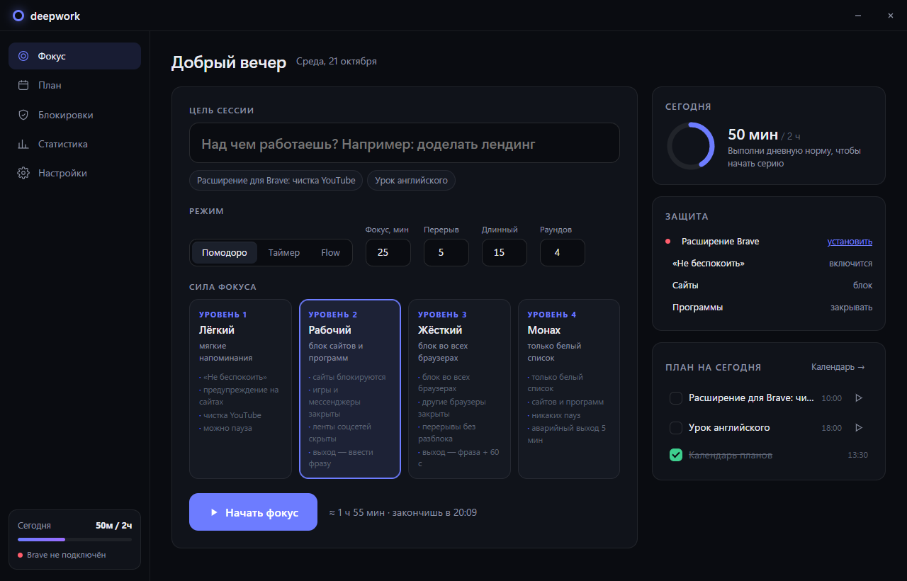
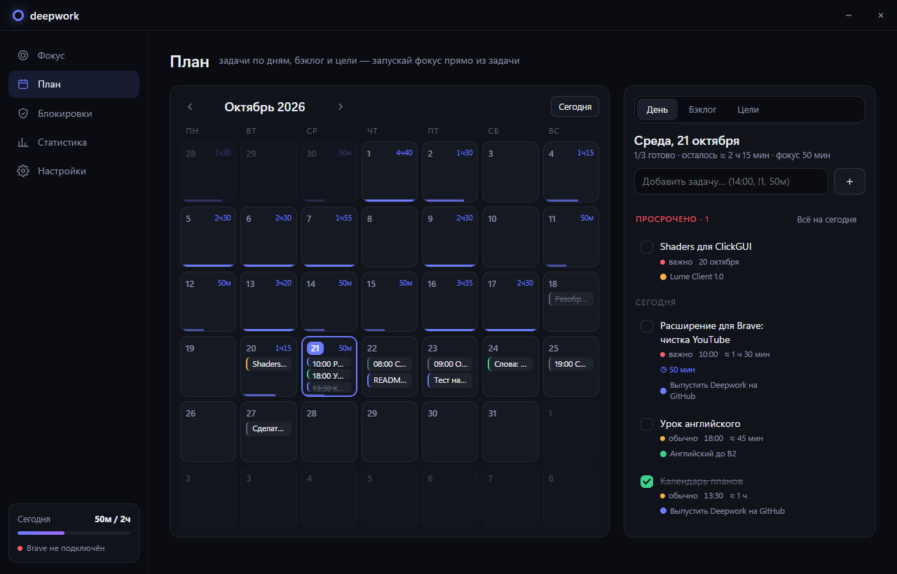
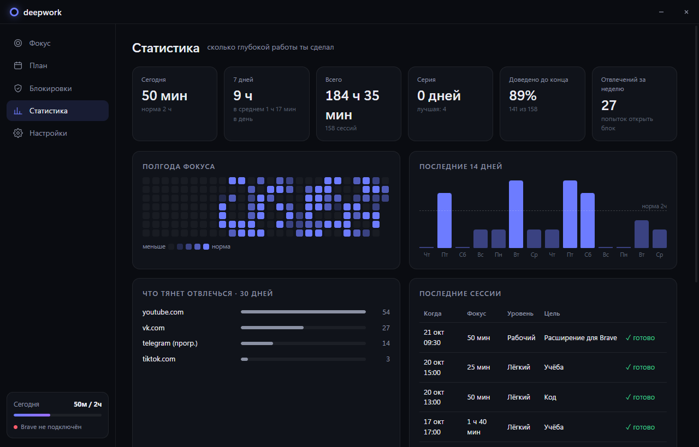

# Deepwork

**Full focus mode for Windows.** Таймер, 4 уровня строгости, отключение уведомлений, блокировка сайтов и программ, чистка YouTube и кликбейта в Brave, календарь планов и статистика.



## Что умеет

**Фокус-сессии**
- Помодоро (фокус / перерыв / длинный перерыв, раунды), обычный таймер, Flow (работаешь сколько идёт, перерыв = 1/5).
- Цель сессии: можно взять задачу из плана на сегодня. Время фокуса записывается на задачу.
- `+5 мин`, пропуск перерыва, пауза (только на лёгком уровне).
- Иконка в трее с кольцом прогресса, собственные всплывающие окна и звук (уведомления Windows в это время выключены).

**4 уровня фокуса** (каждый настраивается в «Настройках»)

| | Лёгкий | Рабочий | Жёсткий | Монах |
|---|---|---|---|---|
| «Не беспокоить» Windows | ✓ | ✓ | ✓ | ✓ |
| Сайты | предупреждение | блок | блок | только белый список |
| Блок в hosts (все браузеры) | | | ✓ | ✓ |
| Программы | | закрывать из списка | закрывать из списка | только белый список |
| Закрывать другие браузеры | | | ✓ | ✓ |
| YouTube, кликбейт, ленты соцсетей | чистка, размытие | всё | всё | всё |
| Разблокировка в перерыв | ✓ | ✓ | | |
| Досрочный выход | подтверждение | ввести фразу | фраза + 60 с | аварийный, 5 мин |

**Расширение для Brave**
- Блокирует сайты через `declarativeNetRequest`. Вместо сайта показывается страница с таймером и целью, а попытка открыть его попадает в статистику.
- YouTube: без Shorts (ссылки `/shorts/` открываются в обычном плеере), пустая главная, без похожих видео, заставок в конце, комментариев, автозапуска и колокольчика.
- Детектор кликбейта: КАПС, «ШОК», «вы не поверите», `!!!`, эмодзи-приманки. Такие заголовки размываются, карточки на YouTube скрываются.
- Ленты VK, Instagram, X, Reddit, Facebook, TikTok и Threads скрываются, сообщения остаются доступны.
- Запрещает сайтам слать push-уведомления во время фокуса.

**План**
- Календарь на месяц с задачами и полоской отработанного фокуса за каждый день.
- Панель дня с быстрым вводом: `14:30 созвон !1 50м` превращается во время, приоритет и оценку. Там же блок «Просрочено» с переносом на сегодня.
- Бэклог для планов без даты. Задачи перетаскиваются на любой день.
- Цели с дедлайном и цветом. Прогресс считается по привязанным задачам.
- Кнопка ▶ у задачи запускает фокус на ней.



**Статистика**: фокус сегодня, за неделю и за всё время, серия дней с выполненной нормой, тепловая карта за полгода, график за 14 дней, что чаще всего тянет отвлечься, последние сессии.



## Установка

Нужен [Node.js](https://nodejs.org) 20 или новее.

```bash
git clone <repo> deepwork
cd deepwork
npm install
npm start
```

### Расширение для Brave

1. Открой `brave://extensions`.
2. Включи **Режим разработчика**.
3. Нажми **Загрузить распакованное** и выбери папку `extension/`.
4. В «Сведениях» расширения включи **Разрешить в приватном режиме**, иначе приватное окно станет лазейкой.
5. Пока запущено приложение Deepwork, расширение подключается само (порт `127.0.0.1:47321`, принимаются только подключения расширений).

Расширение работает и в других Chromium-браузерах (Chrome, Edge, Comet).

## Как это устроено

```
main.js              окно, трей, IPC, связка всего
core/session.js      таймер-автомат: фазы, пауза, выход с задержкой, восстановление после краша
core/enforcer.js     уровень → эффекты (DND, hosts, программы) и их откат
core/sys.js          «Не беспокоить» (WNF quiet hours + реестр), hosts через один UAC
core/apps.js         слежение за процессами (один PowerShell, список раз в 1,5 с)
core/bridge.js       WebSocket для расширения
renderer/            интерфейс (vanilla JS)
extension/           расширение MV3
```

- **«Не беспокоить»** включается через состояние quiet hours Windows и выключение баннеров в реестре. Прежние значения сохраняются и возвращаются после сессии.
- **hosts** правится один раз за сессию (Windows спросит права администратора), внутри меток `# >>> deepwork`. После сессии блок удаляется.
- **Защита от сбоев**: всё, что нужно откатить, пишется в `state.json`. Если приложение упало или его закрыли посреди сессии, при следующем запуске оно продолжит её или вернёт систему как было. Расширение само снимает блоки, когда время сессии вышло, даже если приложение не запущено.
- Системные процессы, консоли и скрипты (`python`, `node`, `java` и др.) не закрываются ни на каком уровне.

Данные лежат в `%APPDATA%\Deepwork` (`data.json` и `state.json`).

## Для разработки

```bash
npm run dry                                   # тестовый режим: блокировки только в лог
node tools/demo-data.js ./demo-profile        # профиль с демо-задачами и сессиями
npx electron . --profile=./demo-profile --shot=shot.png --view=plan   # скриншот экрана
node tools/make-icons.js                      # перерисовать иконки
```

## Дальше

- Сторожевой процесс, который не даёт закрыть приложение через диспетчер задач на уровнях 3–4.
- Мини-виджет с таймером поверх окон.
- Фоновые звуки: шум, дождь.
- Оттенки серого во время фокуса.
- Повторяющиеся задачи в плане.
- Сборка `.exe` установщика (electron-builder).
- Версия расширения для Firefox.

## Лицензия

MIT
