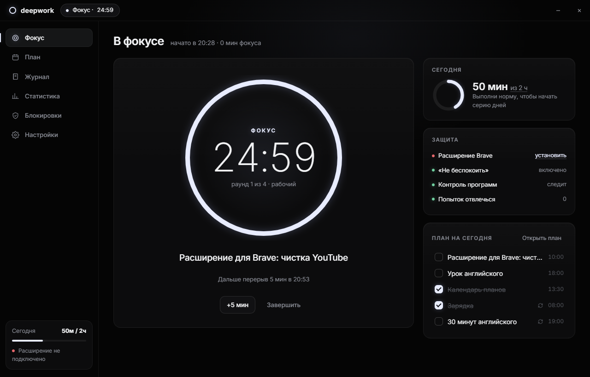
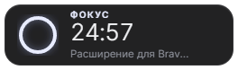
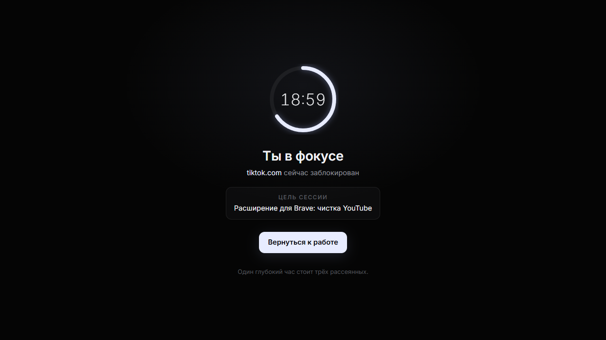
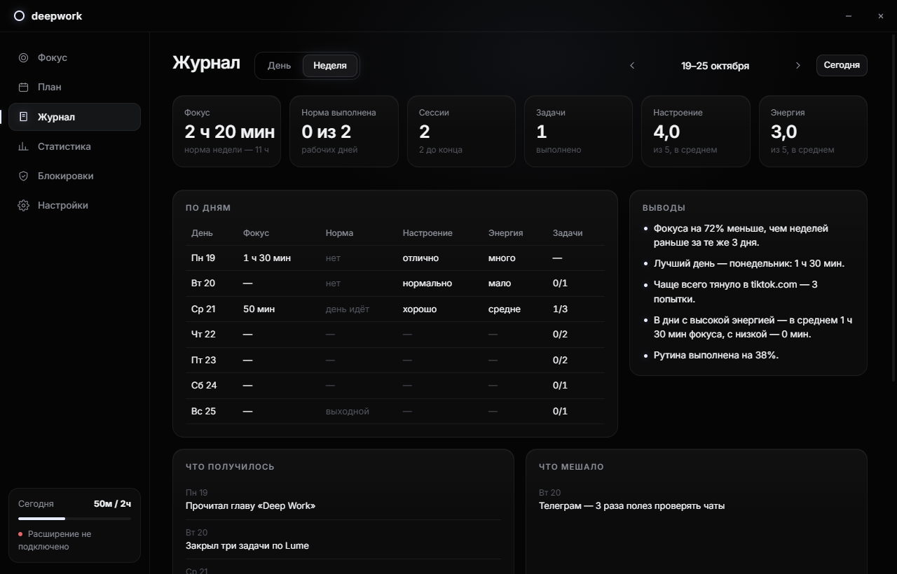

# Deepwork

**Full focus mode for Windows.** Таймер и 4 уровня строгости, отключение уведомлений, блокировка сайтов и программ, чистка YouTube и кликбейта в Brave, рабочие наборы, план с рутинами и журнал с разбором недели.


## Что умеет

**Фокус-сессии**
- Помодоро (фокус, перерыв, длинный перерыв, раунды), обычный таймер или Поток: работаешь сколько идёт, перерыв = 1/5 отработанного.
- Цель сессии: можно взять задачу из плана на сегодня. Время фокуса записывается на задачу.
- **Рабочие наборы**: программы и сайты, которые открываются при старте. Сайты открываются отдельным окном Brave, программы из набора блокировка не закрывает.
- **Таймер на рабочем столе**: маленькое окно поверх всех окон, его можно перетаскивать.
- **Уведомления**: начало перерыва, за минуту до конца перерыва, конец перерыва, конец сессии. Это собственные окошки, поэтому они видны и при включённом «Не беспокоить».
- После сессии можно оставить заметку, она попадёт в журнал.

 

**4 уровня фокуса** (любой пункт меняется в «Настройках»)

| | Лёгкий | Рабочий | Жёсткий | Монах |
|---|---|---|---|---|
| «Не беспокоить» Windows | ✓ | ✓ | ✓ | ✓ |
| Сайты | предупреждение | блок | блок | только белый список |
| Блок в hosts (все браузеры) | | | ✓ | ✓ |
| Программы | | закрывать из списка | закрывать из списка | только белый список |
| Закрывать другие браузеры | | | ✓ | ✓ |
| Разблокировка в перерыв | ✓ | ✓ | | |
| Досрочный выход | в любой момент | ввести фразу | фраза и 60 с | аварийный, 5 мин |

**Brave**
- При старте фокуса закрывает отвлекающие вкладки (или все, кроме рабочих) и возвращает их после сессии.
- Блокирует сайты. Вместо сайта открывается страница с таймером и целью сессии, а попытка зайти попадает в статистику.
- YouTube: без Shorts, пустая главная, без похожих видео, без заставок в конце, без комментариев и автозапуска.
- Кликбейт (КАПС, «ШОК», «вы не поверите», `!!!`) размывается.
- Ленты соцсетей скрываются, а сообщения остаются доступны.
- Сайты не могут присылать push-уведомления.



**План**
- Календарь на месяц с задачами и полоской фокуса за каждый день.
- В панели дня быстрый ввод: `14:30 созвон !1 50м` — сразу время, важность и сколько займёт.
- **Рутины**: повторяющиеся дела по дням недели и процент их выполнения за две недели.
- Бэклог для задач без даты и цели с прогрессом по задачам.


**Журнал**
- Страница дня: настроение, энергия, «что получилось», «что мешало», план на завтра (одной кнопкой переносится в задачи), мысли. Рядом автоматический итог дня.
- Неделя: фокус против нормы, дни с выполненной нормой, настроение и энергия, таблица по дням, итог недели.
- Выводы по данным: сравнение с прошлой неделей за те же дни, лучший день, время суток с самым глубоким фокусом, что чаще всего отвлекало, связь энергии и фокуса.



**Нормы и статистика**: дневная норма, своя для каждого дня недели (0 — выходной, серию он не прерывает). Серия дней, тепловая карта за полгода, график за 14 дней, что тянет отвлечься.


## Установка

Нужен [Node.js](https://nodejs.org) 20 или новее.

```bash
git clone https://github.com/pravorov333-pixel/deepwork
cd deepwork
npm install
npm start
```

### Расширение для Brave

1. Открой `brave://extensions` и включи **Режим разработчика**.
2. Нажми **Загрузить распакованное** и выбери папку `extension/`.
3. В «Сведениях» расширения включи **Разрешить в приватном режиме**, иначе приватное окно станет лазейкой.
4. Расширение подключается само, пока Deepwork запущен (порт `127.0.0.1:47321`, только для расширений).

Расширение работает и в других Chromium-браузерах (Chrome, Edge, Comet).

## Как это устроено

```
main.js              окна (главное, виджет, уведомления), трей, IPC, рабочие наборы
core/session.js      таймер-автомат: фазы, пауза, выход с задержкой, восстановление после сбоя
core/enforcer.js     уровень → эффекты (DND, hosts, программы) и их откат
core/sys.js          «Не беспокоить» (WNF quiet hours + реестр), hosts через один запрос UAC
core/apps.js         слежение за процессами (один PowerShell, список раз в 1,5 с)
core/bridge.js       WebSocket для расширения
renderer/            интерфейс (vanilla JS, шрифт Inter внутри)
extension/           расширение MV3
```

- **«Не беспокоить»** включается через состояние quiet hours Windows и выключение всплывающих уведомлений в реестре. Прежние значения возвращаются после сессии.
- **hosts** правится один раз за сессию внутри меток `# >>> deepwork`, после сессии эти строки удаляются.
- **Защита от сбоев**: всё, что нужно откатить, пишется в `state.json`. Если приложение упадёт, при следующем запуске оно продолжит сессию или вернёт систему как было. Расширение само снимает блоки, когда время сессии вышло.
- Системные процессы и консоли со скриптами (`python`, `node`, `java`) не закрываются никогда.

Данные хранятся в `%APPDATA%\Deepwork` (`data.json`, `state.json`).

## Для разработки

```bash
npm run dry                                    # тестовый режим: блокировки только в лог
node tools/demo-data.js ./demo-profile         # профиль с демо-данными
npx electron . --profile=./demo-profile --shot=shot.png --view=journal --extras   # скриншот (+ виджет и уведомление)
npx electron . --dry --port=47399              # вторая копия рядом с запущенной
```

## Дальше

- Сторожевой процесс против закрытия через диспетчер задач на уровнях 3–4.
- Фоновые звуки и оттенки серого во время фокуса.
- Установщик `.exe` (electron-builder) и версия расширения для Firefox.
- Компаньон для телефона (см. ниже).

### iOS

Приложение для Windows на iPhone не переносится: iOS не даёт приложениям закрывать другие приложения и менять системные настройки. Блокировку там можно сделать только отдельным нативным приложением на Swift через Screen Time API (FamilyControls + ManagedSettings). Для этого нужны Mac с Xcode и аккаунт Apple Developer за $99 в год.

Реальный промежуточный вариант — веб-компаньон (PWA) с таймером, планом, рутинами и журналом, синхронизированный с ПК. Блокировку на телефоне при этом даёт встроенный режим iOS «Фокус».

## Лицензия

Apache 2.0 — см. [LICENSE](LICENSE)
